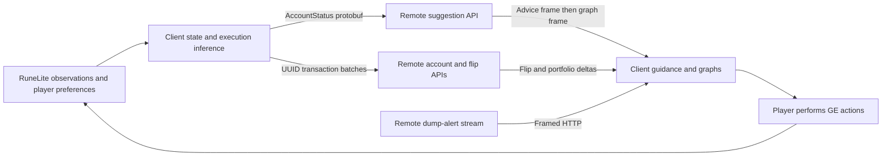

# Flipping Copilot investigation and Flipping Friend implementation direction

17 October 2026, America/Anchorage. Friend source inspected at `0c9ce52d38d280d2810de615857bcb3ae9999d9b`.

Flipping Copilot's installed client was obtained, launched, inventoried and decompiled. The client workflows and consumed server protocol are documented in the linked evidence. A real authenticated price response was decoded through the installed plugin. The private server implementation was not obtained: its model architecture, training data, loss function, execution estimator and deployment remain unknown. This is a comprehensive client/protocol investigation with a bounded server observation, not complete recovery of the backend.

## Deliverables and identity

Private evidence is retained in `local-data/copilot-reverse-engineering/20261017/`, which is ignored by Git. No login response, bearer token, request containing the account name, account database or transaction-history export was copied into the bundle.

| Deliverable | Location under that evidence directory |
| --- | --- |
| Installed plugin | `installed-flipping-copilot.jar` |
| Plugin Hub source snapshot, including license | `hub-pinned-source/`, also `hub-pinned-source.zip` |
| Newer public source checkout | `public-source/` |
| Decompiled installed client | `decompiled-installed/` |
| Client lifecycle, trading workflows, UI and complete source-file coverage | [client-workflows-analysis.md](../../local-data/copilot-reverse-engineering/20261017/client-workflows-analysis.md) |
| Endpoint, authentication, framing, scheduling and field-level protocol report | [protocol-analysis.md](../../local-data/copilot-reverse-engineering/20261017/protocol-analysis.md) |
| Machine-readable reconstructed client contract | [wire-contract.json](../../local-data/copilot-reverse-engineering/20261017/wire-contract.json) |
| Current Friend capability and learning assessment with source citations | [parity-learning-analysis.md](../../local-data/copilot-reverse-engineering/20261017/parity-learning-analysis.md) |
| Package hashes, classes, source comparison and coverage | [artifact-manifest.json](../../local-data/copilot-reverse-engineering/20261017/artifact-manifest.json) |
| REA retained archive evidence | `rea-evidence.json` |
| Bounded live server response and cross-decoder check | `observed-price-response.bin`, `observed-price-summary.json`, `decoder-verification.json` |
| Redacted launch/sync evidence | `runtime-observation.json` |

The installed JAR is 832,937 bytes, SHA-256 `425485cea2f4e81ed9eb8607263f3d5b782fb43c9b6e833a894a946306462c53`. ZIP integrity passes. It contains 269 classes, all Java 11 bytecode, representing 177 outer classes. CFR 0.152 produced 177 Java files; every outer class has both a decompiled output and a counterpart in the pinned public source. CFR emitted eight try/catch reconstruction warnings; these are retained in the manifest, and the public source is used for exact source-level control flow. This is file coverage, not proof that every execution path was exercised or decompiled Java recompiles identically.

The official Plugin Hub descriptor fetched during this investigation pins `c8dbb5155c44156ed3050c50155b086c25815556` (source version 1.14.2). Public HEAD is `0aeeb3970e230d46668511b70d820c43c772ca75` (1.14.3). Nineteen paths differ, chiefly persistence/file-access and UI plumbing. The endpoint handler, status/suggestion/transaction codecs, graph codec and protobuf helpers are unchanged between these source revisions and agree with the inspected installed decompilation. The JAR does not embed a source-commit attestation, so the source descriptor and bytecode corroboration are recorded separately. Public primary sources: [RuneLite Hub descriptor](https://github.com/runelite/plugin-hub/blob/master/plugins/flipping-copilot), [Copilot repository](https://github.com/cbrewitt/flipping-copilot).

REA archive inspection is retained as parent Evidence `ev_043f93661c90c0a4b73d2ac8fd918a32eef48d1682222936c763bf65fe6008df`. Its archive inventory establishes package contents and integrity, not runtime behavior.

## How the client and server interact

The client owns observation, local execution-delta inference, queue persistence/retry, collection guidance, highlights and player-triggered input assistance. The remote service supplies item/side/price/quantity decisions, expected profit/duration, hold instructions, forecast arrays, account flip summaries and portfolio information. No trained predictor or global candidate-ranking model is present in the inspected client.

The status request includes offers, inventory plus uncollected items, separate bag/bank maps, membership, risk, timeframe, blocked/skip state, permitted action types, reserved slots, profit thresholds and synchronization exclusions. It omits a durable source-event identity, observation capture timestamp and explicit request-generation/account-state version. Those omissions matter when designing stronger acceptance and learning evidence for Friend.

The transport is HTTPS with bearer authentication and handwritten protobuf encoders/decoders. It is ordinary HTTP, not gRPC. Dump alerts and Discord login use long-lived framed HTTP responses, not WebSockets. A frame is a varint length followed by protobuf bytes. The suggestion response sends advice first and graph data second; this lets guidance arrive before the larger graph payload. Graph arrays use zigzag/delta encoding.

The contract inventory contains 20 distinct Copilot routes: login/Discord login; suggestions; prices; transaction upload; account-name mapping; flip deltas and transaction export; visualization; portfolio edits/recovery; premium assignment/status; dump alerts; and deletion/orphan operations. The protocol annex and JSON specify every discovered route and 35 client-derived schemas containing 192 fields. Their existence in client code does not prove a current successful response or internal database semantics for every route. Mutation endpoints were inspected statically, not called.

Advice normally becomes stale after ten seconds; an open slot can retain unactioned non-WAIT advice for up to sixty seconds. Login/collection/modification delays and dump priority affect refresh. Transaction sends retry after ten seconds on compatible logged-in state. UUIDs are intended to support resends; durable server deduplication is required by that traffic shape but was not established by a controlled server test.

A client comment references `servergolang/api-contract/api.proto`. That is a useful lead about the author's backend source layout, not possession of the server source or proof of its current deployed language. That file is absent from the inspected repository.

## What was observed live

RuneLite logged loading the preserved plugin at 14:18:10 and again after the usage interruption at 17:52:36 AKDT. The owner confirmed being logged in with Copilot open at the GE. Redacted logs record normal transaction sync callbacks after launch. These are application-log observations, not a full decrypted capture or proof of server accounting.

At 17:54:12 AKDT, one reconstructed, normal own-account `POST /v2/prices` for item 4151, five-minute timeframe and graph enabled returned HTTP 200, `application/protobuf`, 161,751 bytes, in approximately 994 ms. The token stayed in process memory. No transaction/history export, preference update, portfolio edit, premium reassignment or game action was performed by the investigation.

The response contained all 25 historical/volume/forecast series, including 32 prediction timestamps and six aligned mean/upper/lower arrays. The forecast grid is nonuniform and spans 25 hours 35 minutes from its first to last point in this sample. The client labels bands as IQR; their empirical coverage is unverified. Graph scalar prices 29/30 were absent while top-level prices were present, demonstrating that field presence is optional.

The actual installed JAR's `ItemPrice.decodeProto` decoded the retained bytes offline. An independent parser matched all 89,780 array values across the 25 series plus three scalar fields. This establishes the successful price/graph wire interpretation. It does not establish forecast accuracy, suggestion-stream execution, dump delivery, rate-limit policy or the model/training method.

## Server functionality we can reconstruct

| Capability | Evidence-backed contract | Unknown implementation |
| --- | --- | --- |
| Account decision service | Current-state request; BUY/SELL/MODIFY/ABORT/WAIT response with prices, quantity and estimated outcome | Candidate universe, ranking objective, capital optimization, fill estimator and competing-user allocation |
| Market/forecast service | Historical low/high prices, volumes, future means and IQR-labeled bands | Data sources/completeness, architecture, features, retraining, calibration and freshness policy |
| Execution ingestion | UUID batch, signed quantity, price/spend, observation time and attribution booleans | Deduplication scope, acceptance validation, ordering and transaction boundaries |
| Account ledger/portfolio | Flip IDs, account mapping, cursors, portfolio/personal/ghost/disappeared categories and recovery operations | Cost allocation, reconstruction, concurrency, tax provenance and repair policy |
| Dump distribution | Opt-in, account-authenticated framed opportunities with keepalives/reconnect | Detector thresholds, data latency, eligibility and allocation |
| Identity/subscription/sync | JWT login, account-specific views, premium instances and cross-device server records | Authorization internals, infrastructure, retention and billing integration |

Implement those product responsibilities in Friend's existing plugin/core/companion architecture. Reproducing the API shape alone cannot reproduce the private model. A cloud migration would add hosting/sync, not prediction quality.

## Useful behavior and weaknesses to learn from

Preserve the clear next-action workflow, explicit attendance presets, portfolio investigation, compact graph delivery, item search/highlighting, player-key assistance, notifications and account views. Both source trees expose actual 5m/30m/2h/8h choices.

Several inspected Copilot behaviors should not become Friend's target invariants:

- Local offer consistency accepts a match of side OR item OR price OR target quantity; missing predecessors can still emit the entire observed cumulative fill with a local inconsistency flag. This is weaker than episode-bound canonical acceptance.
- Uploads omit the local login/consistency/slot flags. Attribution consists of heuristic booleans rather than immutable exact advice/model/forecast identities. These records alone cannot prove clean causal training labels.
- Successful batch callbacks remove pending transactions from memory without immediately rewriting the disk queue. A restart can resend an already acknowledged UUID. The parser can also convert malformed flip-list bytes into an empty/partial result that reaches success handling. These are source-backed risks, not observed loss or duplicate accounting on the private server.
- Advice acceptance lacks an explicit current account/request-generation/state fence in the inspected controller. UI generation fences do not establish fresh financial authority.
- BUY valuation in the displayed cash/locked-cash calculation uses the full target amount rather than only the unfilled remainder. Its GP/hour clock excludes offline and no-active-offer periods. Neither metric is directly the benchmark's account equity per elapsed hour.

The workflow annex gives exact source/decompilation anchors and limits for each finding. Friend's existing durable identities, account scope, fresh snapshots, conservative unknown-cost handling and prospective forecast lineage should be retained.

## Concrete direction for Flipping Friend

The capability matrix in the learning annex distinguishes implemented source from missing acceptance. Core advice, safe sell/relist/replacement logic, personal-sale quoting, compact UI, player-key assistance, durable realized-profit reporting and the requested cadence presets already exist. Rebuilding them from an older roadmap would duplicate current work.

1. **Finish reliable live workflows and remaining ledger consumers.** Keep existing stock gaps/reserves intact. Demonstrate player-operated buy, partial fill, cancel, collect, relist, sell and restart, with exact quantities/costs and final companion entry authority. Close remaining local policy/reporting consumer gaps without financial replay or automatic adoption of personal items.
2. **Complete prospective measurement and account replay.** Define elapsed session time, attendance and start/end equity. Freeze market inputs, source prefixes, model/configuration and a baseline. Replay the production policy with shared 100M GP, eight slots, buy limits, partial fills, collections, tax, losses and conservative remaining-inventory valuation separately at 5m, 30m, 2h and 8h. The current item-by-item backtester is insufficient.
3. **Fit a challenger on qualified evidence.** Keep original exact-order forecasts and placement/first-fill/completion intervals. Use chronological training/validation cuts, retain early cancellations and ambiguous intervals as censored/unknown, and separate simulated price touches from executions. Compare completion calibration, forecast bands, net account return and drawdown. An accepted recommendation is not proof of player intent or a randomized experiment.
4. **Gate promotion and rollback.** Runtime currently enforces neutral/public-price calibration and `HOLD_FOR_VALIDATION`. Collecting more records cannot itself lift that fence. Promote a frozen challenger only after the prescribed out-of-time/account-return/loss gates pass; retain model/config identities, drift monitoring and rollback. No superiority claim is established now.
5. **Close specific product gaps after the foundation.** Friend's current dump check is a held-position drop alarm with webhook dispatch commented out, not Copilot's streamed opportunity service. Build an independently sourced, evaluated market detector if that workflow is wanted. Separately verify ordinary notification delivery, portfolio/bank badges and colors, and optional cross-device synchronization. Keep the sidebar compact.

The first learning deliverable should be reproducible whole-account evaluation of the current production policy, followed by a censor-aware completion challenger. A more complex model or a copied server-shaped facade is not evidence of improvement. The learning annex specifies source locations and acceptance conditions for each work item.

## Checklist and verification limits

| Original question | State |
| --- | --- |
| Obtain installed plugin files and matching public reference material | Answered; retained JAR, source snapshots, license, hashes and decompilation |
| Run RuneLite with Copilot | Observed plugin load; owner confirmed logged-in GE panel; no investigator game input |
| Explain client features and state/transaction flow | Source-backed analysis with complete file inventory; exhaustive live-path testing remains open |
| Explain plugin/server messages | All discovered client routes/codecs documented; successful live price/graph decoding corroborated |
| Recover complete private server operation | Partial functional reconstruction; private implementation/model/data/training unavailable |
| Identify a path to parity and stronger learning | Current-source matrix, priorities and acceptance provided; implementation/performance experiment remains future work |

Verification performed here: ZIP CRC and SHA-256 inventory; complete outer-class/source/decompilation correspondence; source revision comparison; one bounded server read; actual installed-JAR decode versus independent parser; and report/contract reference checks. No production Java code changed, so no new claim of a clean runtime build or live trade acceptance is made. Existing #80 build/CI receipts are historical evidence attributed in the learning annex. No Friend runtime installation, direct database edit, training or promotion was performed. Copilot's ordinary automatic synchronization ran after launch.
